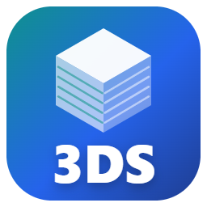

# 3ds — Home Assistant integration

Sends Home Assistant temperature / humidity sensors, printer / device state and camera snapshots to a **G7 (Gnuboard 7)** site running the **📡 IoT Link** plugin.
No YAML — you just pick sensors in the UI.

## ⚠️ Requirements — read this first

This integration **only works together with a G7 site that has the IoT Link plugin installed**. It has no use on its own: every request goes to that site.

| You need | Where |
| --- | --- |
| A [G7 (Gnuboard 7)](https://github.com/gnuboard/g7) site, version 7.0.5+ | your own site (or a site that offers IoT Link to its members) |
| The **IoT Link** plugin (`custom-iot_link`, formerly `custom-ha_link`) installed and activated on that site | **[keidischoi/g7-plugin-custom-iot_link](https://github.com/keidischoi/g7-plugin-custom-iot_link)** — MIT, public |
| A member account on that site | the **site address** and **link code** are shown on the site's `/iot-link` page |

**Installing the plugin on your G7 site** (full guide in the [plugin README](https://github.com/keidischoi/g7-plugin-custom-iot_link#install)):

1. Download `custom-iot_link-<version>.zip` from the [plugin's latest release](https://github.com/keidischoi/g7-plugin-custom-iot_link/releases/latest).
2. Unzip it into the site's `plugins/_pending/` folder (→ `plugins/_pending/custom-iot_link/plugin.php`).
3. Run as the web server user: `php artisan plugin:install custom-iot_link`, `php artisan plugin:activate custom-iot_link`, then `php artisan hooks:clear` and `php artisan cache:clear`.
4. Log in to the site and open `/iot-link` → **➕ Add device** to get the **site address** and **link code** used below.

If you are a member of a site that already runs IoT Link, you can skip this — just get the address and code from the site.

## How it works

- The site never connects into your Home Assistant. This integration only **pushes** values to the site.
- When nobody has looked at the site's page for a while, the site tells the integration to slow down and it does so on its own (state changes are still sent right away). Once the page is opened again, the normal interval returns from the next send.
- **The site admin decides how values are sent**: "on change" (when humidity / temperature changes by a set amount — at most once a minute, plus an occasional send even without change) or "periodically". Either way, a state change triggers one send shortly after. You can make the interval longer (not shorter than the site default) in the integration's **Configure**. If you pick a camera, one small snapshot (640 px wide) is sent only while the device is running.

## Several Home Assistant servers (0.4.0+)

You can use the same link code on more than one Home Assistant server. From 0.4.0 the integration tells the site which server it is (the Home Assistant instance ID and the location name from *Settings › System › General*), so the site shows each server in its own tab, and splits the 📡 waiting area by server. Each server only sees its own devices when it asks the site for its list. Devices added by an older version are tagged automatically the next time they send values.

## Install and connect, step by step

About five minutes the first time. Follow the red boxes and numbers in order.
(The pictures are drawn mock-ups of the screens; Home Assistant may look slightly different depending on the version.)

### 1. Add the repository to HACS

Open HACS → **⋮** (top right) → **Custom repositories** → paste the address below, type **Integration** → **Add**.

```
https://github.com/keidischoi/ha-3ds-link
```

<p align="center"></p>

> The **🧩 Open in my Home Assistant's HACS** button under the site's IoT Link › ➕ Add device skips this step and opens the next screen directly.

### 2. Download and restart

Open **3ds** → **Download** → **restart** Home Assistant (Settings › System › Restart).

<p align="center"></p>

### 3. Add the integration

Settings › Devices & services → **Add integration** (bottom right) → search for **3ds**.

<p align="center"></p>

### 4. Paste the site address and link code

Copy the **site address** and **link code** from the site's IoT Link › ➕ Add device, paste them and press **Submit**.
The link code works like a password — keep it private.

<p align="center"></p>

### 5. ⚡ Find and connect automatically

Choose **⚡ Find and connect automatically** at the top: Home Assistant devices and humidity sensors whose names match your **My Printer** entries and filament **storage locations** on the site come up **already checked**. If they look right, just press **Submit**.

- 🖨️ Printers: found when the nickname or model name is part of the HA device name — state, progress, remaining time and camera are attached in one go.
- 🧵 Storage boxes: a humidity sensor (or its device / area name) containing a filament storage location's name is attached to that location. The **temperature sensor of the same device is attached automatically**.
- Storage boxes are matched only when the names are (almost) the same — e.g. "Dry Box" ↔ "drybox", but not "Box 1" ↔ "Awair room 1".
- Humidity sensors whose names don't match are listed too — checking one sends it to the site's **📡 waiting area**; put it in a box on the site's **📦 board** (drag it).
- After 1–2 minutes they show up as 🟢 on the site's IoT Link page. Later you can search again or uncheck to remove them in this integration's **Configure**.

(The picture below shows the older "all at once" screen — printers now appear in the same place.)

<p align="center"></p>

### 6. Attach printers / equipment that weren't found (one by one)

**Add the integration once more** (address and code are pre-filled) and choose **My Printer — one at a time** or **Company equipment — one at a time**.
**Pick a Home Assistant device** and the state, progress, remaining time, chamber temperature and camera sensors are filled in for you. Check them and press **Submit**.

<p align="center"></p>

### 7. Finish on the site

- **Attach to filament**: in the maintenance log, pick the filament's **storage location** from the list, and that box's humidity / temperature appear on the filament.
- **Alert thresholds · name · where to attach**: ✏️ on the device card on the site's IoT Link page.
- **Camera snapshot visibility**: same ✏️ (default: only you).

## Quick summary (HACS)

1. HACS › ⋮ (top right) › **Custom repositories** › `https://github.com/keidischoi/ha-3ds-link` · type **Integration** › Add
2. Download **3ds** and restart Home Assistant
3. Settings › Devices & services › **Add integration** › "3ds"
4. Paste the **site address** and **link code** shown under the site's IoT Link › ➕ Add device
5. Choose where to attach (filament storage · My Printer · company equipment · other) and the sensors — done

**Many thermo-hygrometers at once**: in step 5 choose "✨ Many temperature/humidity sensors at once" and check the humidity sensors — each one goes into the box whose name (almost) matches, otherwise into the site's 📡 waiting area to be placed on the 📦 board (the same device's temperature sensor is attached automatically). You can add or remove sensors later in the integration's **Configure**.

To attach more printers / equipment, start again from step 3 (address and code are pre-filled).
To change sensors or alert thresholds, press **Configure** on the integration. Deleting the integration also deletes its devices on the site.

## Printer integrations

Any printer integration works — this integration only **reads the sensors that integration creates and sends them**.
When attaching a printer / device, **pick one Home Assistant device** and state, progress, remaining time, job name, chamber temperature and camera are found by name (you can check and fix them on the next screen).

| Integration | State sensor (example) | Notes |
|---|---|---|
| Bambu Lab (ha-bambulab) | `…_print_status` | progress · remaining time · job name · camera |
| Creality WebSocket (ha_creality_ws) | `…_print_status` | states: idle · processing · printing · paused · stopped · completed · error · self-testing |
| Anycubic (Local · Cloud) | state / job sensors | sensor names differ by integration and model — pick them yourself if not found |
| Moonraker (Klipper) | `…_current_print_state` | progress · file name |
| OctoPrint | `…_current_state` | progress |

Fields that aren't found automatically can be picked from the list. State text the site doesn't know is treated as "idle" — please report such text.

## Values sent

| What you pick | Sent as |
|---|---|
| Humidity sensor | `humidity` |
| Temperature sensor | `temperature` |
| State (printer state · switch · plug) | `state` — the site counts running time |
| Progress · remaining time (min) · job name (printer) | `progress` · `remaining_min` · `job` — also passed to the site's "My Printer" |
| Camera | one JPEG (the site keeps only the latest one per device) |

`unknown` / `unavailable` values are not sent.

## Home Assistant version

Home Assistant 2024.4 or later. Only long-standing core features are used (reading states, timers, listening to state changes, config flow) so that new versions are less likely to break it.
Things that can vary by version or camera type, such as camera snapshots, are wrapped separately — if that part fails, values keep being sent.

## Troubleshooting

- Your sensor isn't in the humidity / temperature list: the sensor has no device class. In Settings › Devices & services › Entities, change the sensor's "Show as" to humidity / temperature and it appears in the list.
- The site doesn't turn 🟢: look for `g7_link` in Settings › System › Logs (set the logger level to debug for details).
- "The link code doesn't match": if you generated a new code on the site, delete the integration and add it again with the new code (devices already attached keep sending).
